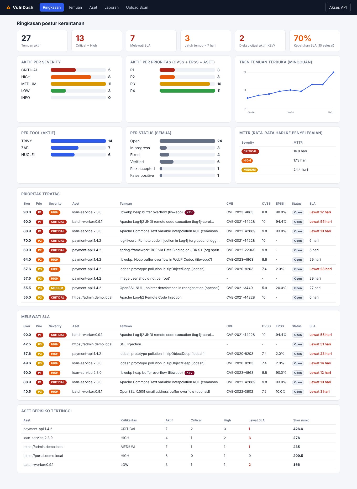
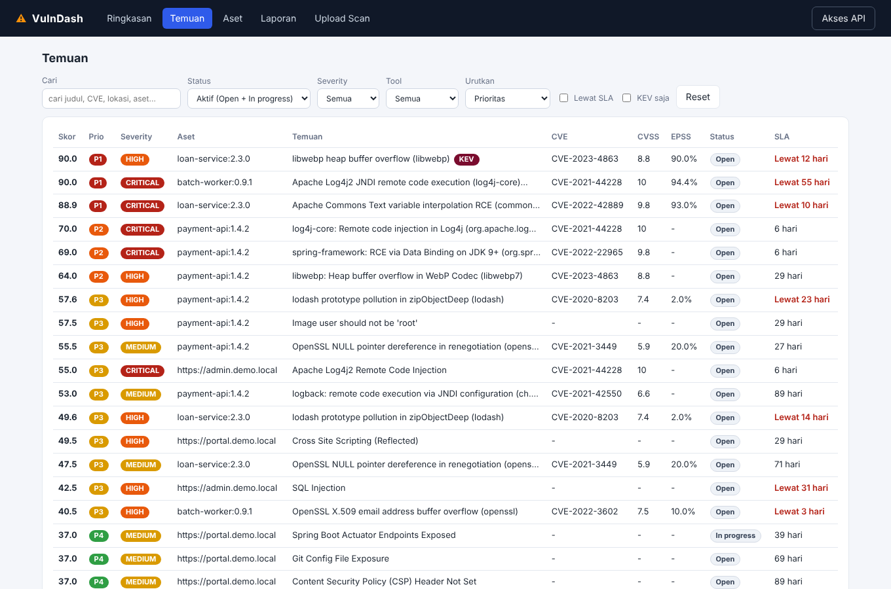
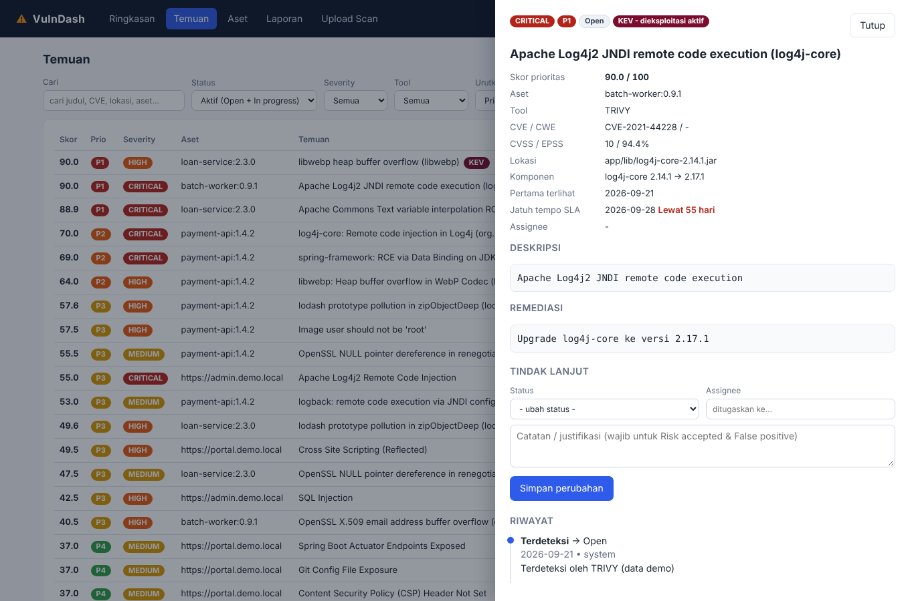

# VulnDash — Vulnerability Management Dashboard

   

Mengagregasi hasil scan **Trivy**, **OWASP ZAP**, dan **Nuclei** ke satu tempat: temuan dideduplikasi, diprioritaskan
dengan **CVSS + EPSS + kritikalitas aset (+ CISA KEV)**, dilacak lewat **workflow remediasi & SLA**, dan dilaporkan otomatis.

Stack: Java 21 · Spring Boot 3.5 · Spring Data JPA · Flyway · PostgreSQL (H2 untuk demo/test) · dashboard web tanpa dependensi (vanilla JS + SVG).

## Tampilan



| Daftar temuan (filter, sort, prioritas) | Detail temuan + workflow remediasi |
|---|---|
|  |  |

_Screenshot memakai data demo (`VULNDASH_DEMO_DATA=true`); aset dan nilai EPSS/KEV pada data demo bersifat ilustrasi._

## Fitur

| Area | Detail |
|---|---|
| Ingest | Upload JSON/JSONL Trivy (vuln, misconfig, secret), ZAP (Traditional JSON), Nuclei (JSONL / array). Satu endpoint untuk CI/CD. |
| Deduplikasi | Fingerprint SHA-256 (tool + aset + rule + lokasi). Scan ulang memperbarui temuan yang sama, bukan menggandakan. |
| Siklus hidup | Temuan baru → `OPEN`. Tidak muncul di scan ulang → `FIXED` otomatis (perlu verifikasi). Muncul lagi → `OPEN` kembali (reopen) + SLA dihitung ulang. |
| Prioritas | Skor 0–100 dan pita P1–P4 (lihat rumus di bawah). Enrichment EPSS (FIRST.org) + status KEV (CISA) otomatis, refresh harian. |
| Workflow | `OPEN → IN_PROGRESS → FIXED → VERIFIED`, plus `ACCEPTED_RISK` / `FALSE_POSITIVE` (wajib justifikasi). Transisi divalidasi server; semua perubahan tercatat di riwayat (audit trail). |
| SLA | Jatuh tempo per severity (default 7/30/90/180/365 hari, bisa diubah di `application.yml`). Dashboard: lewat SLA, jatuh tempo ≤ 7 hari, kepatuhan SLA, MTTR per severity. |
| Laporan | Laporan eksekutif HTML (cetak ke PDF dari browser), ekspor CSV, dan **laporan mingguan otomatis** ke disk (Senin 02:00 UTC). |
| Dashboard | Ringkasan KPI, tren 8 minggu, aset berisiko, daftar temuan dengan filter/sort/paging, panel detail + tindak lanjut, upload scan. |

## Rumus skor prioritas

```
skor = (CVSS / 10) × 50  +  EPSS × 30  +  faktor_kritikalitas_aset × 20        (maks 100)
jika CVE ada di CISA KEV  →  skor = max(skor, 90)
```

- CVSS tidak tersedia (mis. ZAP) → dipakai estimasi dari severity (CRITICAL 9.5, HIGH 7.5, MEDIUM 5.0, LOW 2.5).
- Faktor kritikalitas aset: LOW 0 · MEDIUM 0.25 · HIGH 0.6 · CRITICAL 1.0. Mengubah kritikalitas aset menghitung ulang skor semua temuannya.
- Pita: **P1** ≥ 80 · **P2** ≥ 60 · **P3** ≥ 40 · **P4** < 40.
- Bobot dapat disetel di `vulndash.scoring.*`.

Dengan skor ini, dua temuan CVSS 7.5 bisa berada di ujung yang berbeda: yang EPSS-nya 90% di aset kritikal naik ke P1, yang EPSS-nya 1% di aset non-kritikal tetap P3–P4.

## Menjalankan

### 1. Cepat (H2 in-memory + data demo)

```bash
mvn spring-boot:run -Dspring-boot.run.jvmArguments="-DVULNDASH_DEMO_DATA=true -DVULNDASH_API_KEY=rahasia-saya"
# atau: VULNDASH_DEMO_DATA=true VULNDASH_API_KEY=rahasia-saya mvn spring-boot:run
```
Buka http://localhost:8080. Data hilang saat aplikasi berhenti.

### 2. Docker Compose (PostgreSQL)

```bash
echo "VULNDASH_API_KEY=$(openssl rand -hex 24)" > .env
docker compose up --build
```

### 3. Dengan PostgreSQL sendiri

```bash
SPRING_PROFILES_ACTIVE=postgres DB_URL=jdbc:postgresql://localhost:5432/vulndash DB_USER=... DB_PASSWORD=... \
VULNDASH_API_KEY=... java -jar target/vuln-dashboard-1.0.0.jar
```

Aktifkan enrichment EPSS/KEV (butuh internet keluar): `VULNDASH_ENRICHMENT_ENABLED=true`.

## Integrasi scanner / CI-CD

```bash
# Trivy
trivy image --format json -o trivy.json myapp:1.0
./scripts/upload-scan.sh TRIVY trivy.json myapp:1.0 HIGH

# OWASP ZAP (baseline)
zap-baseline.py -t https://staging.example.com -J zap.json
./scripts/upload-scan.sh ZAP zap.json

# Nuclei
nuclei -u https://staging.example.com -jsonl -o nuclei.jsonl
./scripts/upload-scan.sh NUCLEI nuclei.jsonl
```

Atau langsung dengan curl:

```bash
curl -H "X-API-Key: $VULNDASH_API_KEY" -F tool=TRIVY -F asset=myapp:1.0 -F criticality=HIGH -F file=@trivy.json http://localhost:8080/api/scans
```

Contoh file ada di `samples/`.

> **Catatan auto-resolve:** temuan yang *tidak muncul* pada scan ulang (aset + tool yang sama) otomatis ditandai `FIXED`.
> Itu benar untuk scan penuh, tapi keliru bila scan Anda parsial (mis. hanya sebagian template Nuclei).
> Untuk scan parsial kirim `autoResolve=false`.

## API ringkas

| Method | Path | Keterangan |
|---|---|---|
| POST | `/api/scans` | Upload scan (multipart: `tool`, `file`, opsional `asset`, `criticality`, `autoResolve`) 🔑 |
| GET | `/api/scans` | 20 scan terakhir |
| GET | `/api/findings` | Filter: `status`, `severity`, `tool`, `assetId`, `q`, `overdue`, `kev`, `minPriority`; `sort` (priority, cvss, epss, due, firstSeen, title), `dir`, `page`, `size` |
| GET | `/api/findings/{id}` | Detail + riwayat + transisi status yang diizinkan |
| PATCH | `/api/findings/{id}` | `{status?, assignee?, note?}` 🔑 |
| GET | `/api/assets` · PATCH `/api/assets/{id}` | Daftar aset · ubah kritikalitas/pemilik 🔑 |
| GET | `/api/dashboard/summary` | Seluruh agregat dashboard |
| GET | `/api/reports/executive` · `/findings.csv` | Laporan HTML · ekspor CSV |
| POST | `/api/reports/generate` | Tulis laporan ke disk 🔑 |
| GET | `/api/reports/files` · `/files/{name}` | Daftar/unduh laporan tersimpan |

🔑 = wajib header `X-API-Key`. Set `VULNDASH_PROTECT_READS=true` agar GET juga wajib key.

## Keamanan (sengaja dirancang demikian)

- **Data scan = input tak tepercaya.** Judul/URL temuan bisa berisi payload dari target yang dipindai. UI hanya memakai `textContent` (tanpa `innerHTML`), laporan HTML di-escape, dan CSV diberi prefiks `'` pada sel berawalan `= + - @` (anti formula injection).
- CSP ketat (`script-src 'self'`), `nosniff`, `X-Frame-Options: DENY`, `Referrer-Policy: no-referrer`.
- API key dibandingkan **constant-time**; operasi tulis selalu butuh key. Ganti default `dev-key-change-me` di production.
- Nilai **secret** dari Trivy tidak disimpan — hanya jenis dan lokasinya.
- Unduh laporan divalidasi (whitelist nama + cek path) → tidak bisa path traversal. Query pencarian memakai parameter terikat (JPA Specification), karakter `%`/`_` di-escape.
- Upload dibatasi 50 MB; error ke klien tidak membocorkan stack trace.

Batasan yang perlu diketahui: autentikasi hanya satu API key bersama (belum per-user/RBAC); untuk produksi multi-tim pasang di belakang reverse proxy dengan SSO atau tambahkan Spring Security + OIDC.

## Arsitektur

```
 Trivy / ZAP / Nuclei ──► POST /api/scans ──► Parser ──► Ingest (fingerprint, upsert, auto-resolve, reopen)
                                                              │
                         EPSS (FIRST) + KEV (CISA) ◄── Enrichment ──► Scoring + SLA ──► PostgreSQL (Flyway)
                                                              │
 Dashboard (static SPA) ◄── REST API ◄── Dashboard/Finding/Asset/Report service ──► laporan mingguan (scheduler)
```

Paket: `parser` (satu parser per tool, mudah ditambah — implementasikan `ScanParser`), `service` (ingest, scoring, SLA, enrichment, laporan),
`web` (controller, filter keamanan), `domain`/`repo` (JPA).

## Test

```bash
mvn verify      # 20 test: parser, scoring/SLA, workflow, ingest/reopen/auto-resolve, API key, escaping laporan, path traversal
```

## Pengembangan lanjutan

- Parser tambahan: Grype, Semgrep/SARIF, OWASP Dependency-Check, Burp.
- Auth per-user + RBAC (OIDC), notifikasi Slack/email untuk SLA yang akan jatuh tempo, integrasi tiket (Jira).
- Agregasi di sisi database (GROUP BY / materialized view) bila temuan aktif > ratusan ribu.
- Ekspor PDF langsung dan SBOM (CycloneDX) sebagai sumber data.
